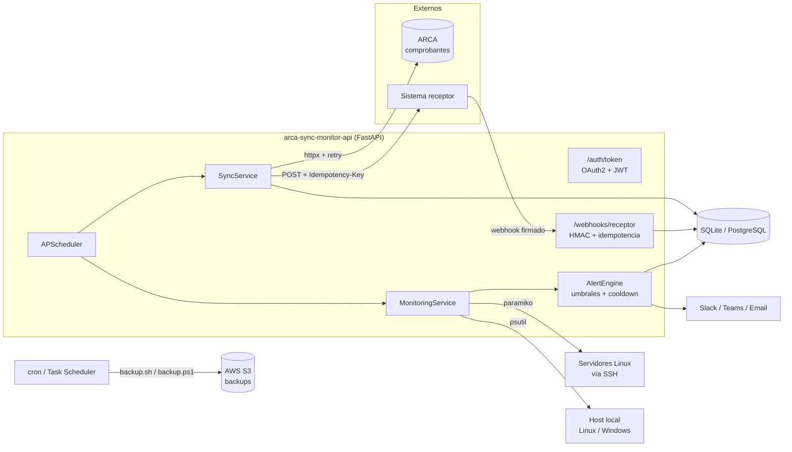
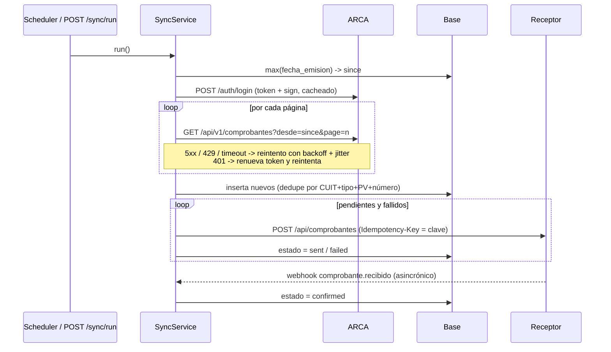

# ARCA Sync & Monitor API

API REST en **FastAPI** que sincroniza comprobantes electrónicos (facturas) desde **ARCA** hacia un sistema **receptor**, y además monitorea servidores **Linux y Windows Server** (CPU, memoria, disco y servicios) con alertas automáticas y backups programados a **S3**.

- Autenticación **OAuth2 + JWT** (`password` para usuarios y `client_credentials` para integraciones), con scopes por endpoint
- Sincronización **incremental** con **reintentos** (backoff exponencial + jitter), **deduplicación** e idempotencia hacia el receptor
- Recepción de **webhooks** del receptor con firma **HMAC-SHA256**, protección anti-replay e idempotencia por `event_id`
- **Monitoreo** local con psutil y remoto por SSH (paramiko) sin agentes, alertas por umbral con cooldown y aviso de recuperación por webhook (Slack/Teams) o email
- **Logging estructurado** en JSON con `X-Request-ID` propagado
- **Backups** con Bash + cron (Linux) y PowerShell + Programador de tareas (Windows Server), más un uploader en Python con boto3
- **Mock de ARCA y del receptor** en Flask para desarrollo local y tests
- **Docker**, **docker-compose**, **GitHub Actions** (CI + deploy a EC2) y 62 tests con pytest

## Stack

Python · FastAPI · Flask · Pydantic v2 · SQLAlchemy 2.0 · httpx · PyJWT · APScheduler · psutil · paramiko · boto3 · Pytest · Ruff · Bash · PowerShell · cron · Docker · GitHub Actions · AWS (EC2, S3, CloudWatch)

## Arquitectura



### Flujo de sincronización



### Estructura

```
app/
  core/           config (pydantic-settings), security (JWT, PBKDF2, HMAC), logging JSON
  db/             engine/sesiones y modelos SQLAlchemy 2.0
  api/            dependencias y routers (auth, sync, comprobantes, webhooks, monitoring, health)
  services/       ArcaClient, ReceptorClient, SyncService, WebhookService, retry
  monitoring/     collector local (psutil), remoto (SSH), alertas, notificadores, hosts YAML
  scheduler.py    jobs periódicos de sync y monitoreo
mock_arca/        mock de ARCA + receptor (Flask)
scripts/          backup.sh, backup.ps1, register_task.ps1, crontab.example, s3_backup.py
deploy/           bootstrap de EC2, script de deploy remoto, override de compose, policy IAM
config/hosts.yaml hosts a monitorear
tests/            pytest (auth, webhooks, sync, alertas, monitoreo, backups)
```

## Endpoints

| Método | Ruta | Scope | Descripción |
|---|---|---|---|
| `POST` | `/auth/token` | - | Emite JWT. `grant_type=password` o `client_credentials` |
| `GET` | `/auth/me` | cualquiera | Identidad y scopes del token |
| `POST` | `/sync/run` | `sync:write` | Ejecuta una sincronización incremental (409 si ya hay una en curso) |
| `GET` | `/sync/runs` | `comprobantes:read` | Historial de corridas (filtro `status`, paginado) |
| `GET` | `/sync/runs/{id}` | `comprobantes:read` | Detalle de una corrida |
| `GET` | `/comprobantes` | `comprobantes:read` | Lista con filtros `estado`, `cuit_receptor`, `punto_venta`, `desde`, `hasta` |
| `GET` | `/comprobantes/{id}` | `comprobantes:read` | Detalle de un comprobante |
| `POST` | `/webhooks/receptor` | firma HMAC | Confirmaciones / rechazos del receptor |
| `GET` | `/monitoring/hosts` | `monitoring:read` | Último snapshot de cada host (`?refresh=true` fuerza recolección) |
| `GET` | `/monitoring/hosts/{name}/metrics` | `monitoring:read` | Métricas en vivo de un host |
| `POST` | `/monitoring/check` | `monitoring:read` | Corre los chequeos y dispara alertas |
| `GET` | `/monitoring/alerts` | `monitoring:read` | Historial de alertas (filtros `host`, `severity`) |
| `GET` | `/health` · `/health/ready` | - | Liveness y readiness (verifica la base) |

Documentación interactiva en `http://localhost:8000/docs`.

## Cómo correrlo

### Local (Python 3.11+)

```bash
python -m venv .venv
source .venv/bin/activate          # Windows: .venv\Scripts\activate
pip install -r requirements-dev.txt
cp .env.example .env               # Windows: copy .env.example .env

# Terminal 1: mock de ARCA + receptor en :5001
python -m mock_arca.app

# Terminal 2: API en :8000
uvicorn app.main:app --reload
```

Para ver los reintentos y la confirmación por webhook en acción, levantar el mock con:

```bash
MOCK_FAILURE_RATE=0.2 MOCK_WEBHOOK_URL=http://127.0.0.1:8000/webhooks/receptor python -m mock_arca.app
```

### Probar el flujo

```bash
# Token de integración
TOKEN=$(curl -s -X POST localhost:8000/auth/token \
  -d grant_type=client_credentials -d client_id=integration-client -d client_secret=integration-secret \
  | jq -r .access_token)

curl -X POST -H "Authorization: Bearer $TOKEN" localhost:8000/sync/run
curl -H "Authorization: Bearer $TOKEN" "localhost:8000/comprobantes?estado=confirmed&limit=5"
curl -H "Authorization: Bearer $TOKEN" "localhost:8000/monitoring/hosts?refresh=true"
```

### Docker Compose (API + mock + PostgreSQL)

```bash
cp .env.example .env
docker compose up -d --build
docker compose logs -f api
```

En compose el scheduler interno queda habilitado: sincroniza cada `SYNC_INTERVAL_MINUTES` y monitorea cada `MONITORING_INTERVAL_SECONDS`.

### Tests y lint

```bash
pytest                     # 62 tests, SQLite en memoria, sin red
pytest --cov               # con cobertura
ruff check . && ruff format --check .
```

Los tests usan `httpx.MockTransport` para simular fallas de ARCA y del receptor, `httpx.WSGITransport` para correr el mock Flask en proceso, y fakes de psutil y paramiko para el monitoreo.

## Integración con ARCA

`ArcaClient` consume un servicio HTTP de consulta de comprobantes y recibe un `ArcaAuthProvider` intercambiable:

| Provider | Uso |
|---|---|
| `StaticTokenAuth` | token fijo, para pruebas (`ARCA_AUTH_MODE=static`) |
| `TokenEndpointAuth` | pide `token` + `sign` a `POST /auth/login` y los cachea hasta su vencimiento (`ARCA_AUTH_MODE=token`, lo que expone el mock o un gateway propio delante de ARCA) |
| `WsaaAuthProvider` | punto de extensión para el WSAA real |

El flujo de WSAA real (no incluido) consiste en armar el TRA (`LoginTicketRequest`), firmarlo como CMS/PKCS#7 con el certificado y la clave del CUIT, invocar `loginCms` por SOAP y guardar el ticket (dura unas 12 h y no se puede pedir otro mientras siga vigente). Implementándolo en `WsaaAuthProvider.get_credentials` el resto del sistema no cambia.

Ante un `401` el cliente invalida el token, lo renueva y reintenta una vez. Los `5xx`, `429` y errores de red se reintentan con backoff exponencial y *full jitter*: `delay = random(0, min(max_delay, base * 2^(n-1)))`.

## Webhooks del receptor

El receptor firma cada evento con `X-Signature: sha256=<HMAC(secret, "{X-Timestamp}.{body}")>`.

- La firma se verifica sobre el body crudo y con comparación en tiempo constante
- Se rechazan timestamps fuera de `WEBHOOK_TOLERANCE_SECONDS` (anti-replay)
- `event_id` es único en la base: un reenvío devuelve `200` con `duplicate: true` sin reprocesar

```json
{
  "id": "evt_8f2c1d",
  "type": "comprobante.recibido",
  "data": { "clave": "20123456789-001-00002-00000123", "receptor_id": "rcp_91ab" }
}
```

Tipos soportados: `comprobante.recibido` (pasa a `confirmed`) y `comprobante.rechazado` (pasa a `rejected` con `motivo`).

## Monitoreo y alertas

Los hosts se definen en `config/hosts.yaml`:

- `type: local` usa psutil en el host donde corre la API. En Windows Server los servicios se consultan con `psutil.win_service_iter()` y en Linux con `systemctl is-active`
- `type: ssh` se conecta por paramiko y ejecuta un único comando que lee `/proc/stat`, `/proc/meminfo`, `df` y `systemctl`, sin instalar agentes. Por defecto exige que el host esté en `known_hosts`

El `AlertEngine` evalúa umbrales `warning`/`critical` (globales por variables de entorno o por host en el YAML):

- No repite una alerta activa hasta que pase `ALERT_COOLDOWN_MINUTES`
- Si la severidad escala de warning a critical notifica de inmediato
- Cuando la métrica se normaliza emite un evento `resolved`
- Servicio caído o host inaccesible es siempre `critical`

Canales: log (siempre), webhook (`ALERT_WEBHOOK_URL`, compatible con Slack) y email SMTP (`SMTP_HOST` + `ALERT_EMAIL_TO`). Si un canal falla los demás igual se envían.

## Backups a S3

| Script | Plataforma | Qué hace |
|---|---|---|
| `scripts/backup.sh` | Linux | `tar.gz` de datos y config (+ `pg_dump` opcional), SHA256, `aws s3 cp` con SSE, rotación local y en S3, lock con `flock` |
| `scripts/crontab.example` | Linux | backup diario 03:15 y, opcionalmente, sync y monitoreo vía API |
| `scripts/backup.ps1` | Windows Server | `Compress-Archive`, SHA256, `aws s3 cp`, rotación local y en S3, log a archivo |
| `scripts/register_task.ps1` | Windows Server | registra las tareas en el Programador de tareas como SYSTEM |
| `scripts/s3_backup.py` | ambas | alternativa en Python con boto3 (`python scripts/s3_backup.py --source ... --bucket ...`) |

```bash
# Linux
sudo cp scripts/backup.sh /opt/arca-sync/scripts/ && sudo chmod +x /opt/arca-sync/scripts/backup.sh
echo 'S3_BUCKET=mi-bucket-backups' | sudo tee /etc/arca-sync/backup.env
crontab scripts/crontab.example
```

```powershell
# Windows Server (PowerShell como Administrador)
.\scripts\register_task.ps1 -Bucket mi-bucket-backups -BackupTime "03:15"
```

En `deploy/iam-backup-policy.json` hay una policy IAM de mínimo privilegio para asociar al Instance Profile, así no hace falta guardar access keys en el servidor. Conviene sumar una *lifecycle rule* en el bucket como segunda red de seguridad para la rotación.

## Deploy en AWS EC2

1. Lanzar una instancia Ubuntu 24.04 con un Instance Profile que tenga la policy de backups y un Security Group que permita 22 (solo desde IPs conocidas) y 8000 o 443 detrás de un ALB/Nginx
2. Ejecutar `deploy/ec2-bootstrap.sh` como root (o pasarlo como *user-data*). Instala Docker, compose y AWS CLI y crea `/opt/arca-sync`
3. Cargar en GitHub (environment `production`) los secrets:

   | Secret | Contenido |
   |---|---|
   | `EC2_HOST` | IP o DNS de la instancia |
   | `EC2_USER` | usuario SSH (ej. `ubuntu`) |
   | `EC2_SSH_KEY` | clave privada autorizada en la instancia |
   | `EC2_KNOWN_HOSTS` | salida de `ssh-keyscan -H <host>` |
   | `APP_ENV_FILE` | contenido del `.env` de producción (incluye `POSTGRES_PASSWORD`, `JWT_SECRET`, URLs reales de ARCA y receptor) |

4. Crear un tag y pushearlo

   ```bash
   git tag v1.0.0 && git push origin v1.0.0
   ```

`deploy.yml` corre los tests, copia el release por SCP, escribe el `.env`, ejecuta `deploy/remote_deploy.sh` (releases versionados en `/opt/arca-sync/releases`, symlink `current`, se conservan los últimos 5) y verifica `/health/ready`. En producción se usa `deploy/docker-compose.prod.yml`: sin mock, Postgres sin puerto expuesto y logs a CloudWatch.

Para volver a una versión anterior alcanza con relanzar el workflow (`workflow_dispatch`) sobre el tag previo.

## Configuración

Todas las opciones están en `.env.example`. Las más relevantes:

| Variable | Default | Descripción |
|---|---|---|
| `DATABASE_URL` | `sqlite:///./arca_sync.db` | `postgresql+psycopg://...` para Postgres |
| `JWT_SECRET` | - | secreto de firma de los JWT (cambiar en producción) |
| `ARCA_BASE_URL` / `ARCA_CUIT` | mock local | servicio de ARCA y CUIT emisor |
| `RECEPTOR_BASE_URL` / `RECEPTOR_API_KEY` | mock local | sistema receptor |
| `WEBHOOK_SECRET` | - | secreto HMAC compartido con el receptor |
| `RETRY_MAX_ATTEMPTS` | `5` | intentos por request |
| `SCHEDULER_ENABLED` | `false` | habilita los jobs internos de sync y monitoreo |
| `CPU_WARNING` … `DISK_CRITICAL` | 80/95, 80/95, 80/90 | umbrales globales |
| `ALERT_COOLDOWN_MINUTES` | `15` | ventana anti-spam de alertas |

## Decisiones de diseño

- **httpx sincrónico** en los servicios: el trabajo es I/O secuencial con reintentos y SQLAlchemy sync; FastAPI ejecuta esos endpoints en su threadpool
- **Retry propio** en lugar de tenacity: es poco código, sin dependencias, y permite inyectar `sleep`/`random` en los tests
- **PBKDF2-SHA256** de la stdlib para contraseñas, sin dependencias nativas
- **Estado del envío por comprobante** (`pending → sent → confirmed/rejected`, o `failed` con reintento en la próxima corrida) en lugar de una cola externa, suficiente para el volumen esperado
- El lock de sync es por proceso; con varias réplicas conviene un `pg_advisory_lock` o habilitar el scheduler en una sola instancia
- `create_all` crea el esquema al iniciar; para evolucionarlo en producción el paso natural es sumar Alembic
